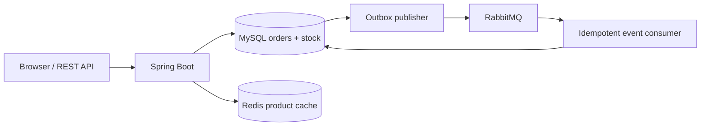
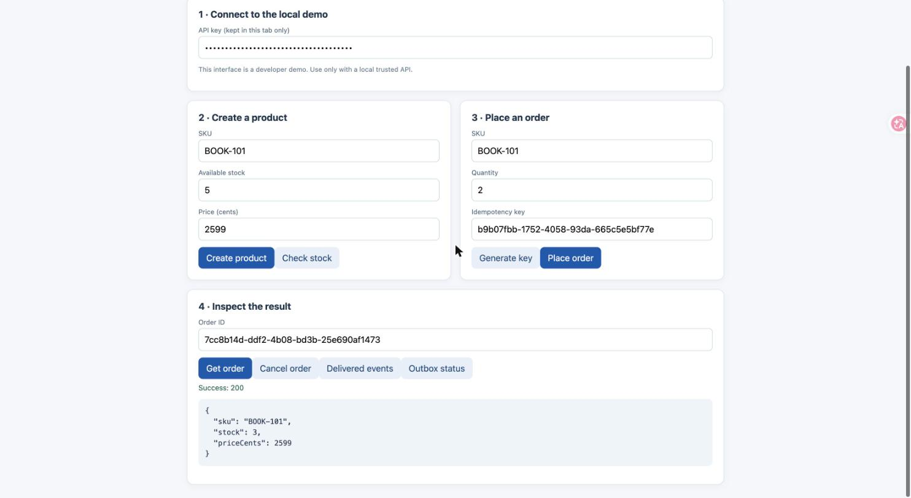

# Java Order & Inventory Platform

A small Java backend project that demonstrates **correct inventory updates, reliable event delivery, and practical deployment**.

**Stack:** Java 21 · Spring Boot 3.5 · MySQL · Redis · RabbitMQ · Docker

## 1. The problem

An online store can receive two orders for the last item at the same time. A database update may succeed while a message to another service fails. Retries may also create duplicate orders.

We need to **avoid overselling, handle retries safely, and avoid losing order events**.

## 2. The solution

- **MySQL transaction:** Save the order and decrease stock together; a conditional SQL update prevents overselling.
- **Idempotency key:** Repeating the same request returns the same order without decreasing stock twice.
- **Transactional outbox:** Save the event in MySQL with the order. A background worker sends it to RabbitMQ and retries if the broker is unavailable.
- **Redis cache:** Cache product reads for 20 seconds; invalidate after writes. Order creation always checks MySQL, never cached stock.
- **Cancellation:** Restore stock once and record a cancellation event.
- **Developer UI and tests:** Try the workflow from a browser and check the Java rules and HTTP APIs.





## 3. Quick start

Requires **Docker and Docker Compose**.

```bash
# If using the ZIP, extract it and enter its folder.
# If published on GitHub, clone the repository first.
cd java-order-inventory-platform
cp .env.example .env
# Edit .env: replace all demo passwords and APP_API_KEY with your own values.
docker compose up --build -d
```

Open **http://localhost:8080** and paste `APP_API_KEY` from your `.env` file. Then:

1. Create `BOOK-101` with stock `5`.
2. Place an order for quantity `2`.
3. Check that stock is now `3`.
4. Retry with the same idempotency key: stock stays at `3`.
5. Cancel the order: stock returns to `5`.
6. Select **Delivered events** to inspect RabbitMQ processing (it may take a few seconds).

Health check: `http://localhost:8080/actuator/health`.

To test the full API workflow from a terminal (requires curl and Python 3), run:

```bash
APP_API_KEY="$(sed -n 's/^APP_API_KEY=//p' .env)" ./scripts/demo.sh
```

To stop: `docker compose down`. To **delete all demo database data**: `docker compose down -v` (destructive).

## 4. What is inside

| Folder | Purpose |
|---|---|
| `src/main/java` | Original API, order rules, SQL, caching, outbox and consumer |
| `src/main/resources/static` | Simple web interface for the demo |
| `src/test` | Domain tests and Spring HTTP integration tests |
| `scripts` | Standalone Java check and end-to-end demo |
| `docs` | Architecture, test evidence, security and interview walkthrough |
| `.github/workflows` | Maven CI and optional Docker integration workflow |

## 5. Testing

```bash
# Domain rules only (no Maven needed)
./scripts/test-core.sh

# Full test suite (Java 21 + Maven)
mvn test

# End-to-end with Docker stack running
APP_API_KEY="$(sed -n 's/^APP_API_KEY=//p' .env)" ./scripts/demo.sh
```

14 Maven tests + 21 standalone domain assertions pass on Java 21/22/27. See [test report](docs/TEST_REPORT.md).

## 6. Verified Results (Docker Integration Test)

Tested on macOS with Docker Desktop. Full stack (`docker compose up --build`) deploys MySQL 8.4, Redis 7.4, RabbitMQ 4.1, and the Spring Boot API. End-to-end test via `scripts/demo.sh`:

- **Product creation** — `POST /api/products` creates DEMO SKU with stock=5, cached in Redis
- **Order placement** — `POST /api/orders` deducts stock atomically (5→3 for qty=2)
- **Idempotency** — replay with same idempotency key returns same order ID, stock stays at 3
- **Cancellation** — `POST /api/orders/{id}/cancel` restores stock (3→5), recorded as CANCELLED
- **Event delivery** — transactional outbox publishes 2 events (ORDER_CREATED, ORDER_CANCELLED) to RabbitMQ, confirmed delivered within seconds

### Concurrent Order Safety (Oversell Prevention)

Created a product with stock=2, then fired 5 simultaneous order requests (each qty=1, unique idempotency keys):

- **Result:** exactly 2 orders placed (HTTP 201), 3 rejected with "Insufficient stock" (HTTP 409)
- **Final stock:** 0 (correct — no oversell, no negative stock)
- The conditional SQL `UPDATE ... SET stock = stock - ? WHERE stock >= ?` serializes under MySQL row locks

### RabbitMQ Outage Recovery (Outbox Resilience)

1. Placed an order while RabbitMQ was running — event delivered within seconds
2. Stopped RabbitMQ container (`docker stop`)
3. Placed another order — **HTTP 201 success** (order + outbox row committed to MySQL; broker unavailable does not block the order)
4. Restarted RabbitMQ container (`docker start`)
5. Outbox publisher retried and delivered the queued event — confirmed via `/api/orders/{id}/events`

### Limitations

- **No horizontal scaling tested.** The outbox publisher is single-instance; clustered deployment would need leader election or partitioned polling.
- **No multi-instance contention test.** Concurrent safety was verified with parallel API requests to a single instance; a multi-replica deployment with a shared database was not tested.

## 7. Documentation

[Architecture](docs/ARCHITECTURE.md) · [Interview Demo](docs/INTERVIEW_DEMO.md) · [Test Report](docs/TEST_REPORT.md) · [Skill Coverage](docs/SKILL_COVERAGE.md) · [Known Limits](docs/KNOWN_LIMITS.md) · [Security](SECURITY.md)

## Ownership

This project was designed and built by Yi Wang as a portfolio demonstration. The application code (domain logic, API, outbox publisher, idempotent consumer), tests, Docker configuration, demo scripts, and documentation are original work. It uses the following upstream software: Spring Boot 3.5, MySQL, Redis, and RabbitMQ — each with their own licenses.

## License

[MIT](LICENSE)
